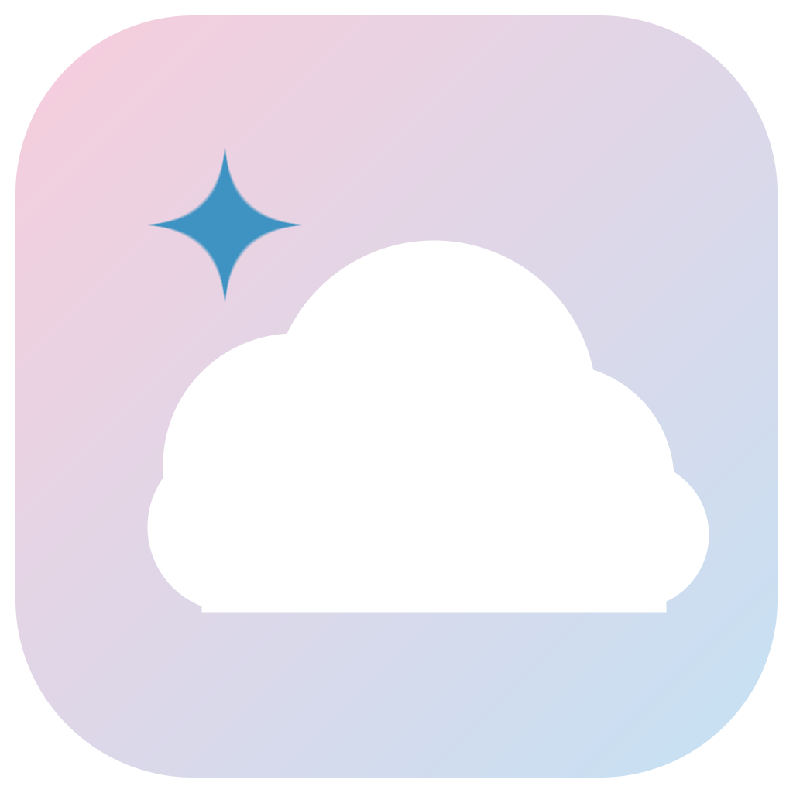

<div align="center">



# Pink Cloud ☁️

**A cute, dreamy replacement for the Windows taskbar, Start menu and more.**
Soft colors, springy animations, a music visualizer, synced lyrics and five color themes.

### [⬇️ Download Pink Cloud for Windows](https://github.com/NotUnis/pink-cloud/raw/main/download/Pink-Cloud-Setup.exe)

<sub>Windows 10/11 · about 5 MB · installs just for you, no admin needed</sub>

</div>

---

## Install in 3 steps

1. **[Download `Pink-Cloud-Setup.exe`](https://github.com/NotUnis/pink-cloud/raw/main/download/Pink-Cloud-Setup.exe)**
2. Double-click it. Windows may say *"Windows protected your PC"* because the app isn't from a big
   company: click **More info → Run anyway**.
3. Pink Cloud starts right away. Want it every time you turn on your PC? Open quick settings
   (the Wi-Fi/volume icons) and switch on **Start with Windows**.

**To go back to the normal Windows taskbar:** quick settings → the exit icon at the bottom right.
Uninstall it like any app: Windows Settings → Apps → Installed apps → Pink Cloud.

## What's inside

| | |
|---|---|
| 🧁 **Taskbar** | See-through and always there; clicks on its empty parts go through. A light glides under the app you're using; drag apps to reorder them. |
| 🎵 **Now Playing** | Album art that spins like a record, song, artist and controls, for Spotify, YouTube and anything else that plays. |
| 🌈 **Music visualizer** | Bars that dance to whatever's playing, tinted by the album art. |
| 🎤 **Synced lyrics** | Lines pop up around your screen as the song is sung, letter by letter with a little wave. |
| 👂 **Song recognition** | In games (and players that don't say what's playing) Pink Cloud recognizes the song by sound, so you still get the song, art and lyrics. |
| 🎮 **Game mode** | While a game fills your screen, pop-ups wait, lyrics shrink to the top edge, and **Alt+G** shows an overlay with the time, your song, volume and PC stats. |
| ✨ **Quick search** | **Alt+Space**: apps, open windows, files, settings, sums (`12*7`), units (`5 km in miles`) and the weather from one bar. |
| 🔄 **Updates** | Pink Cloud tells you when there's a new version and updates itself in one click. |
| 🪟 **Live previews & Alt+Tab** | Hover an app to see its windows; Alt+Tab opens a frosted switcher with live views. |
| 🔎 **Start menu** | All your apps (Store apps too), recent files, search through apps and files, a power panel with a cancellable countdown. |
| 🔔 **Notifications** | Pink pop-ups and a notification panel behind the bell, with Do not disturb. |
| 🌤️ **Desktop widgets** | Clock, calendar, weather, PC stats, music and a note, right on your wallpaper. Drag them anywhere. |
| 🌙 **Idle screen** | Step away and a dreamy clock with your song fades in. Never over videos or games. |
| 🗂️ **Files** | Tabs, one-click sorting remembered per folder (with groups like *Today* and *Yesterday*), Quick Look (Space), drag to move, box select, pinned folders. Folders you open anywhere (and Win+E) open here. |
| ⚙️ **Settings** | Every Pink Cloud option, plus shortcuts to every Windows settings page. |
| 🎨 **Themes** | Pink Cloud, Lavender, Mint, Sunset, **Cosmos** 🌌 and **Grove** 🌿 (forest light and glowing jade glyphs), a theme that matches **your wallpaper** (Wallpaper Engine too) or the song's cover, and **your own colors** with a code to share. Each in light and dark. |
| 🔊 **Sounds** | Soft pops and chimes when things open and notifications arrive (switch off in Settings). |

Wallpaper Engine keeps working with Pink Cloud.

## Good to know

- **What it changes while it runs:** it hides the Windows taskbar (switching it to auto-hide, and
  saving your original setting first), makes a tap of the Windows key open Pink Cloud's Start menu,
  shows the background apps' tray icons itself, and makes folders open in Pink Cloud Files.
  Everything goes back when you close Pink Cloud.
- **If something ever gets stuck,** right-click `restore-windows-taskbar.ps1` from this repo →
  *Run with PowerShell* and the normal taskbar comes back.
- **Your data stays on your PC.** The visualizer listens to your speakers' output but records nothing.
  Notifications are read from a copy of Windows' own list. Pink Cloud only goes online for lyrics
  ([LRCLIB](https://lrclib.net)), weather ([Open-Meteo](https://open-meteo.com)), update checks (this page),
  and song recognition: when it's on and no app says what's playing, ~10-second clips of your PC's
  sound go to [AudD](https://audd.io). Switch it off in Settings → Look and feel.
- **Milky Way photo** on the Cosmos idle screen (`ui/img/milky-way.jpg`, cropped): ESO/S. Brunier,
  [CC BY 4.0](https://creativecommons.org/licenses/by/4.0/), from [eso.org](https://www.eso.org/public/images/eso0932a/).

## Build it yourself

You need [Node.js](https://nodejs.org), [Rust](https://rustup.rs) and the Visual Studio C++ build tools.

```
npm install
npm run dev      # live-reloading dev build (set PINK_CLOUD_PREVIEW=1 to keep the Windows taskbar)
npm run build    # the installer, in src-tauri/target/release/bundle/nsis
```

Preview mode (`pink-cloud.exe --preview`) runs Pink Cloud above the normal taskbar and changes nothing.

Built with [Tauri](https://tauri.app) (Rust + HTML/CSS). Where things live:

- `src-tauri/src/shell.rs`: talks to Windows (windows, icons, apps, volume, power, taskbar swap, autostart)
- `src-tauri/src/tray.rs`: background apps' tray icons
- `src-tauri/src/audio.rs` · `media.rs`: the visualizer and Now Playing
- `src-tauri/src/notify.rs`: notifications
- `src-tauri/src/files.rs`: folders, drives and file actions
- `src-tauri/src/keys.rs`: Windows key and Alt+Tab
- `src-tauri/src/main.rs`: windows, popups and everything the screens ask for
- `ui/*.html`: the screens; `ui/shared.css` and `ui/shared.js` hold the themes, menus and animations

Icons by [Phosphor](https://phosphoricons.com) (MIT).
